<!-- Profil GitHub - Khalil -->
<div align="center">
  
</div>

---




<br clear="right"/>

---

## `// à propos`

Étudiant en **Licence 3 à l'École Supérieure Polytechnique de Dakar (ESP/UCAD)**, titulaire d'un **DUT Génie Logiciel et Systèmes d'Information (2026)**.
À la recherche d'un **stage en cybersécurité** : sécurité offensive, pentesting, analyse de vulnérabilités.
Objectif : devenir expert en cybersécurité et contribuer au développement de la cybersécurité en Afrique.

- 🥇 N°1 au Sénégal sur **HackerDNA**
- 🏴 Actif sur **HackTheBox** et HackerDNA
- 🛡️ Stage chez **ATECH Cybersécurité**

---

## `// stack & outils`

<div align="center">


</div>

---

## `// projets`

| ID | Projet | Description | Stack |
|:--:|--------|-------------|-------|
| `[01]` | 🛡️ **InterVtech** | Plateforme de gestion d'interventions techniques (stage ATECH) | `Web` |
| `[02]` | 🔑 **PKI ATECH** | Hiérarchie d'autorités de certification et tableau de bord | `EJBCA` `OpenSSL` |
| `[03]` | 🎣 **PhishGuard AI** | Détection de phishing par ML (F1 99,16 %), score explicable | `Django` `React` `Python` |
| `[04]` | 🚌 **SénTransport** | Application de transport pour le réseau de bus de Dakar | `Flask` `React` `Leaflet` |
| `[05]` | ☁️ **Serverless SOC** | Détection d'IP malveillantes sur AWS | `Lambda` `DynamoDB` `SNS` |
| `[06]` | 🔐 **CyberSec Labs** | Labs de pentesting, CTF et write-ups | `Kali Linux` `Nmap` `Burp` |
| `[07]` | 📰 **La Tribune** | Site d'actualités avec CRUD sécurisé | `PHP` `MySQL` |

---

## `// certifications`

`Cisco` · `HackerDNA (pentesting junior)` · `Huawei` · `Codingame`

---

## `// objectifs 2026-2027`

```python
# current_missions.py

targets = {
    "cybersec" : ["Stage pentest", "HackTheBox (AD)", "Bug bounty", "OSCP prep"],
    "web"      : ["OWASP Top 10", "Sécurité API", "Supabase / JWT / RLS"],
    "cloud"    : ["AWS Security", "Docker", "CI/CD"],
    "network"  : ["CCNA", "Active Directory"],
}

for domain, missions in targets.items():
    print(f"[▶] {domain}: {', '.join(missions)}")
```

---

## `// contact`

<div align="center">

[](https://linkedin.com/in/ibrahima-diagne-7a1a41342)
[](mailto:ibrahimadiagne@esp.sn)


```bash
┌──[khalil@esp-dakar]─[~]
└─$ echo "Always learning, always building."
Always learning, always building.
┌──[khalil@esp-dakar]─[~]
└─$ █
```

</div>
